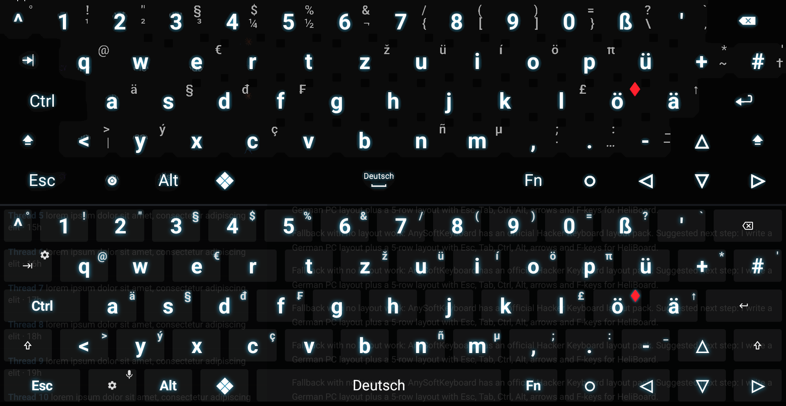
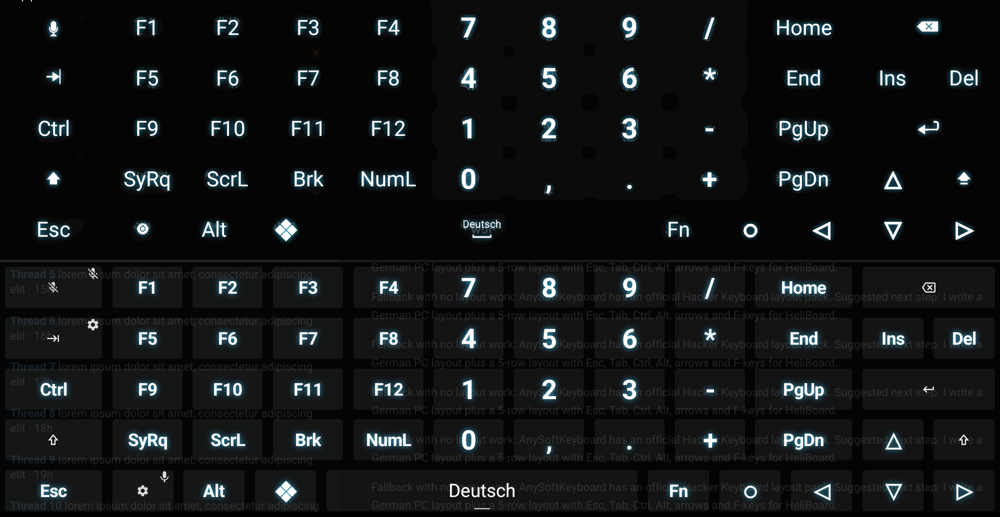
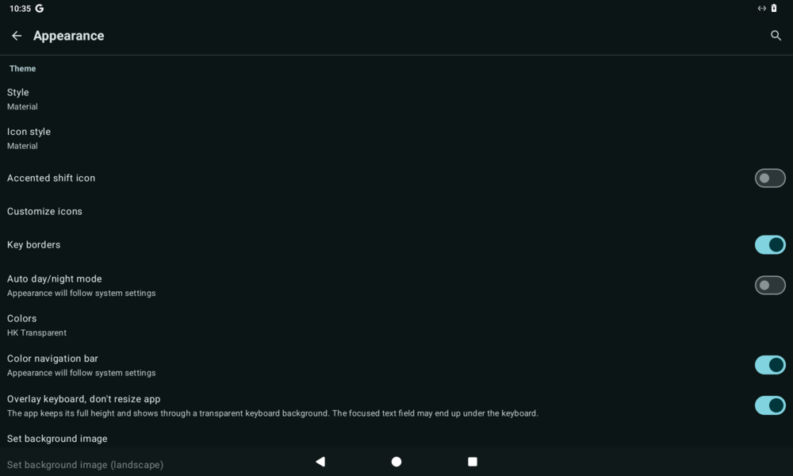

# HeliBoard as Hacker's Keyboard

Custom layouts and a settings backup that make [HeliBoard](https://github.com/HeliBorg/HeliBoard)
look and work like [Hacker's Keyboard](https://github.com/klausw/hackerskeyboard): German QWERTZ PC
layout, full 5 rows with Esc, Tab, Ctrl, Alt, ❖, arrows, an Fn layer with F1–F12 and a numpad, the
same long-press characters, and the transparent "neon" theme.

It works with **stock HeliBoard**. An optional [patched HeliBoard build](https://github.com/Bluscream/HeliBoard/releases/tag/hk-overlay-1)
adds the parts stock HeliBoard can't do: overlay mode, glowing bold labels and a few extra key codes.

| | |
| :--- | :--- |
| **Downloads** (backup zips, layouts, patched APK) | [Releases](https://github.com/Bluscream/heliboard-hackerskeyboard-layout/releases/latest) |
| **Patched HeliBoard** (source and APK) | [Bluscream/HeliBoard, branch `hk-overlay`](https://github.com/Bluscream/HeliBoard/tree/hk-overlay), [release `hk-overlay-1`](https://github.com/Bluscream/HeliBoard/releases/tag/hk-overlay-1) |
| **Hacker's Keyboard fork** (mic key works with any voice IME, settings export) | [Bluscream/hackerskeyboard releases](https://github.com/Bluscream/hackerskeyboard/releases) |

## Screenshots

Hacker's Keyboard (top) vs. patched HeliBoard with this config (bottom), main layer:

Fn layer (F-keys, numpad, Home/End, PgUp/PgDn):

Overlay mode in the patched build: the app keeps its full height and shows through the keyboard.

> The Hacker's Keyboard screenshots are from a real tablet. The app behind the translucent keys was
> painted out for privacy, which is why their key backgrounds look flat.

## What's in it

| File | What |
| :--- | :--- |
| `heliboard-config/heliboard-hk-backup-stock.zip` | Full HeliBoard settings backup for **stock** HeliBoard: layouts, "HK Transparent" colours, hint and popup options, no suggestion strip, landscape height 126 %, font scale 150 % |
| `heliboard-config/heliboard-hk-backup-patched.zip` | The same for the **patched** build. It also turns on overlay mode, label glow and bold labels, and uses the extra key codes |
| `heliboard-config/layouts/hk_de_main.json` | Main layout: number row plus three letter rows, German QWERTZ PC, with the popups and hints from Hacker's Keyboard |
| `heliboard-config/layouts/hk_functional.json` | Functional keys: Tab, Ctrl, Shift, ↑, Backspace, Enter, and the bottom row (Esc, settings/mic, Alt, ❖, Space, Fn, ○, ◁ ▽ ▷) |
| `heliboard-config/layouts/hk_fn_layer.json` | Hacker's Keyboard's Fn layer, used as HeliBoard's numpad layout. The Fn key toggles it |
| `heliboard-config/layouts/*_patched.json` | Variants that use the patched build's extra key codes |
| `patches/000[1-4]-*.patch` | The HeliBoard patches, also on the [`hk-overlay`](https://github.com/Bluscream/HeliBoard/tree/hk-overlay) branch |
| `tools/gen_layouts.py`, `tools/gen_backup.py` | Generators for the layouts and zips (`python3 tools/gen_layouts.py && python3 tools/gen_backup.py --height-landscape 1.26 --font-scale 1.5`) |
| `images/` | Screenshots |

## Import

> [!WARNING]
> Restoring a backup zip **replaces all HeliBoard settings**, including colours, layouts and
> every option. Back up your current settings first: **Settings → Advanced → Backup and restore → Backup**.

**Whole look (recommended):** download `heliboard-hk-backup-stock.zip` for stock HeliBoard, or
`heliboard-hk-backup-patched.zip` for the patched build, from the
[release](https://github.com/Bluscream/heliboard-hackerskeyboard-layout/releases/latest). Then, in HeliBoard:

1. **Settings → Advanced → Backup and restore → Restore**, and pick the zip.
2. The German (Deutsch) subtype now uses the "HK Deutsch" layout, the colour theme is "HK Transparent",
   the suggestion strip is hidden, and the landscape height is 126 %.

**Only the layouts, keeping your other settings:**

- **Main layout:** Settings → Languages & Layouts → Deutsch → Layout → "+" (custom) → load `hk_de_main.json`.
- **Functional keys:** Settings → Secondary layouts → Functional keys → load `hk_functional.json` (or `hk_functional_patched.json`).
- **Fn layer:** Settings → Secondary layouts → Numpad, **and** Numpad (landscape) → load `hk_fn_layer.json` (or `hk_fn_layer_patched.json`).

> [!TIP]
> **Pick the zip with Android's own file picker.** Choose it from the picker's built-in roots,
> such as *Internal storage* or *Downloads*, not from a third-party file manager's entry. With the
> MiXplorer provider, Restore failed with "nothing to restore in the given file" even though the zip
> was valid.

## Switching over

**From official HeliBoard to the patched build**

1. In official HeliBoard: **Settings → Advanced → Backup and restore → Backup**, and save the zip.
2. Install `HeliBoard-hk-overlay-1.apk`. It is a debug-variant build with package name
   `helium314.keyboard.debug`, shown as **"HeliBoard debug"**, and signed with a personal key. So it installs
   **next to** official HeliBoard; uninstalling the official app is optional.
3. Enable **HeliBoard debug** in **Android Settings → System → Keyboard → On-screen keyboard** (the path varies by
   device), and select it.
4. Pick **one** of:
   - **Keep your settings:** in the patched build, **Backup and restore → Restore** your zip from step 1. You can
     then load single layouts as shown above.
   - **Hacker's Keyboard look:** restore `heliboard-hk-backup-patched.zip`. It replaces everything, so restoring
     your own zip afterwards undoes the HK look, and the other way round. Keep your zip from step 1 as the way back.

**Back to official HeliBoard:** the same in reverse. In the patched build, **Backup and restore → Backup**. Then
in official HeliBoard, **Restore** that zip, or `heliboard-hk-backup-stock.zip`. Stock HeliBoard ignores the
overlay, glow and bold settings, and the extra key codes do nothing there. Then switch keyboards in Android's
settings, and uninstall the patched build if you like.

**From Hacker's Keyboard:** there is no automatic conversion of Hacker's Keyboard settings. The backup zips
recreate the HK look and layout. To keep a copy of your HK settings, use the settings export in the
[Hacker's Keyboard fork](https://github.com/Bluscream/hackerskeyboard/releases).

## Differences from Hacker's Keyboard

| | Stock HeliBoard + this config | Patched HeliBoard + this config |
| :--- | :--- | :--- |
| Key layout, long-press characters, hints | Same as Hacker's Keyboard (German) | Same |
| Settings key / mic | Settings key next to Esc: **tap = settings, long-press = voice input**, like HK's shared settings/mic key. Tab also has settings on long-press | Same |
| Fn layer | HeliBoard's numpad layout, toggled by Fn | Same |
| Forward-Del, ○ (D-pad centre), SysRq, ScrLk, Brk, NumL | Labels shown, keys do nothing (stock HeliBoard has no key codes for them) | Work |
| App behind the keyboard | The app is resized to end above the keyboard, so nothing shows through the transparent theme | **Overlay mode** (Appearance → "Overlay keyboard, don't resize app"): the app shows through, like HK |
| Label glow, bold labels | Not available | On (hidden prefs `key_text_glow_radius_dp`, `key_text_glow_color`, `key_text_bold`, set by the patched zip) |
| Suggestions, gesture typing, clipboard, emoji, dictionaries | HeliBoard's own (suggestion strip hidden by the zip) | Same |
| Other languages | German layout only. The other HK languages aren't converted | Same |

## Patches (patched build only)

1. Key codes for Forward-Del, D-pad centre (○), SysRq, ScrollLock, Break and NumLock.
2. Optional label glow. Hidden prefs: `key_text_glow_radius_dp` (int) and `key_text_glow_color` (ARGB int).
3. Optional bold labels. Hidden pref: `key_text_bold`.
4. **Appearance → "Overlay keyboard, don't resize app"** (off by default). HeliBoard then reports its content
   insets at the bottom of the input view, as its floating keyboard does, so the app keeps its full height. Touches still
   reach only the keys through `touchableRegion`.

They apply to HeliBoard [`3e91b4f`](https://github.com/HeliBorg/HeliBoard/commit/3e91b4f1bf711a8bd3eb2d049c8b285fcc9cfa10).
They are not submitted upstream, and HeliBoard doesn't accept LLM-generated pull requests.

## Credits

- [Hacker's Keyboard](https://github.com/klausw/hackerskeyboard) by Klaus Weidner (Apache-2.0). The key map,
  long-press characters, Fn layer and neon colours are taken from its German layouts and themes.
- [HeliBoard](https://github.com/HeliBorg/HeliBoard) (GPL-3.0). Everything here runs on it.

Tested on one Android 14 tablet and in Waydroid. This is a personal project, not affiliated with either.

## Licence

[GPL-3.0](LICENSE), matching HeliBoard. The patches are derived from HeliBoard's source.
