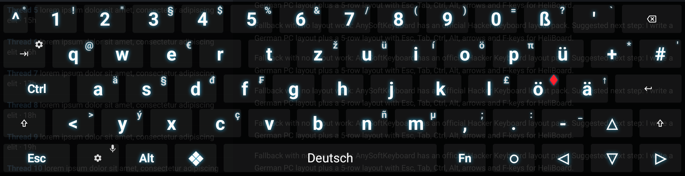
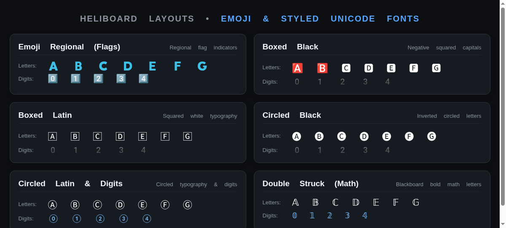

# HeliBoard Layouts

A collection of custom layouts, themes, and configuration packages for [HeliBoard](https://github.com/HeliBorg/HeliBoard) (the customizable and privacy-conscious open-source Android keyboard).

For full features (such as transparent overlay mode, glowing bold text, and extra hardware keycodes), use the [patched HeliBoard build](https://github.com/Bluscream/HeliBoard/releases/tag/hk-overlay-1).

---

## Available Layouts

| Preview | Layout | Description | Downloads & Links |
| :---: | :--- | :--- | :--- |
|  | [**Hacker's Keyboard**](layouts/hackerskeyboard/) *(German QWERTZ)* | Full 5-row PC layout replicating [Hacker's Keyboard](https://github.com/klausw/hackerskeyboard): &bull; Dedicated arrow keys, Esc, Tab, Ctrl, Alt, ❖ (Meta) &bull; Fn layer with F1–F12 & full numeric numpad &bull; Transparent dark neon theme &bull; **Classic:** 1:1 original key & popup mapping &bull; **Enhanced:** Adds emoji picker (`Win + .`), text emotes, and styled font long-press popups | 📖 [Documentation](layouts/hackerskeyboard/) 💾 [Classic (.zip)](layouts/hackerskeyboard/HackersKeyboardLayoutClassic.zip) 💾 [Enhanced (.zip)](layouts/hackerskeyboard/HackersKeyboardLayoutEnhanced.zip) 📂 [Layout JSONs](layouts/hackerskeyboard/layouts/) |
|  | [**Emoji & Styled Fonts**](layouts/emojifonts/) *(Unicode Typography)* | Direct-typing keyboard layouts for decorative Unicode typography & emoji from [FontKeyboard](https://github.com/Bluscream/FontKeyboard): &bull; **Emoji Regional:** 🇦 🇧 🇨 &bull; 0️⃣ 1️⃣ 2️⃣ &bull; **Boxed Black:** 🅰 🅱 🅲 &bull; **Boxed Latin:** 🄰 🄱 🄲 &bull; **Circled Black:** 🅐 🅑 🅒 &bull; **Circled Latin:** Ⓐ Ⓑ Ⓒ &bull; ⓪ ① ② &bull; **Double Struck:** 𝔸 𝔹 ℂ / 𝕒 𝕓 𝕔 &bull; 𝟘 𝟙 𝟚 &bull; Top-row long-press styled number hints | 📖 [Documentation](layouts/emojifonts/) 💾 [All Fonts (.zip)](layouts/emojifonts/EmojiFontsLayouts.zip) 📂 [Layout JSONs](layouts/emojifonts/layouts/) |

---

## Releases & Downloads

Pre-built restore zip files are available on the [Releases page](https://github.com/Bluscream/heliboard-layouts/releases/latest).

## Discussions & Community

Have ideas for new layouts, requests, or questions? Check out the [GitHub Discussions](https://github.com/Bluscream/heliboard-layouts/discussions)!

## Contributing

Want to contribute a layout?
1. Create a subdirectory under `layouts/<layout-name>/`.
2. Add your layout JSON files, a generator script (if applicable), screenshots in `images/`, and a `README.md` describing the layout and how to import it.
3. Submit a pull request!
