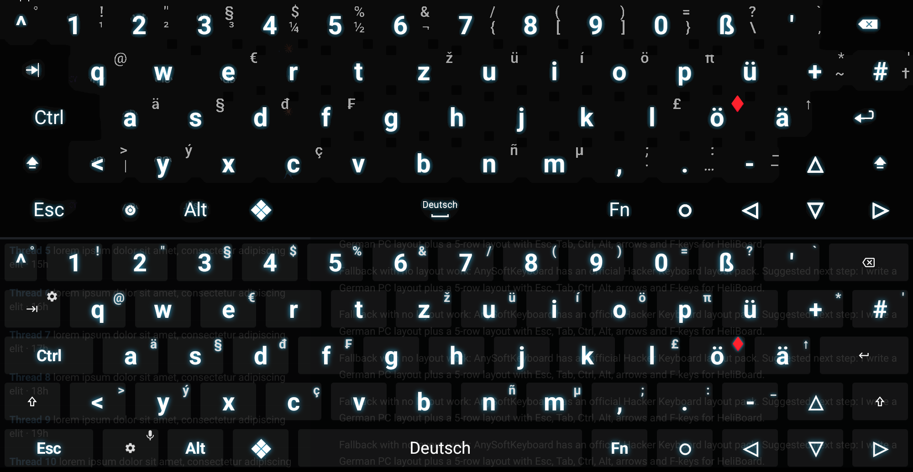
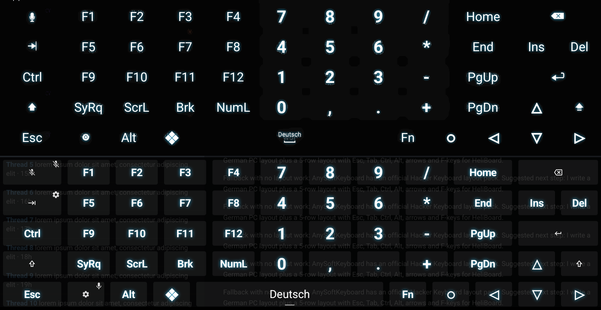
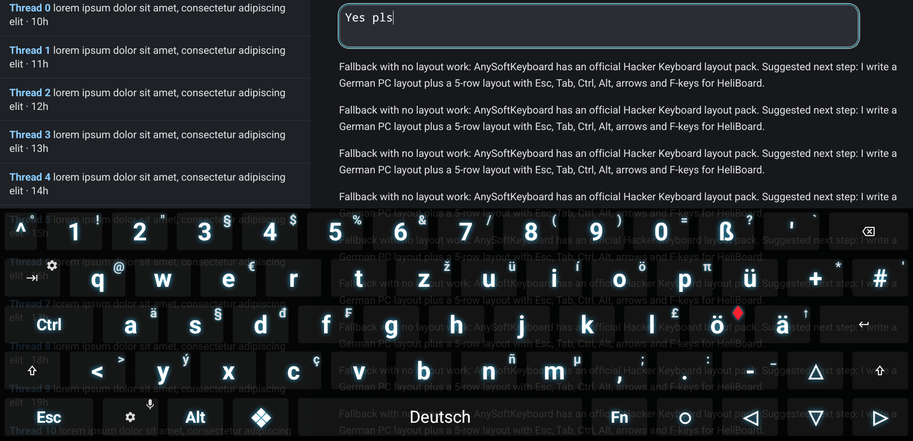

# Hacker's Keyboard for HeliBoard

Custom layouts and settings backups that make [HeliBoard](https://github.com/HeliBorg/HeliBoard)
look and work like [Hacker's Keyboard](https://github.com/klausw/hackerskeyboard): German QWERTZ PC
layout, full 5 rows with Esc, Tab, Ctrl, Alt, ❖, arrows, an Fn layer with F1–F12 and a numpad, the
same long-press characters, and the transparent "neon" theme.

Designed for the [patched HeliBoard build](https://github.com/Bluscream/HeliBoard/releases/tag/hk-overlay-1)
(adds overlay mode, glowing bold labels, and hardware F-row / D-pad keycodes).

## Screenshots

Hacker's Keyboard (top) vs. patched HeliBoard with this config (bottom), main layer:

Fn layer (F-keys, numpad, Home/End, PgUp/PgDn):

Overlay mode in the patched build: the app keeps its full height and shows through the keyboard.

## Versions

Two layout packages are provided:
- **`HackersKeyboardLayoutClassic.zip`:** Exact 1:1 replica of Hacker's Keyboard (German 5-row PC layout, original long-press alternates, hints and popups).
- **`HackersKeyboardLayoutEnhanced.zip`:** Modernized layout incorporating:
  - **Emoji key:** integrated into long-press of `.` (period), following the PC `Win + .` convention.
  - **Common text emotes & emoticons:** on long-press of their initial letters (e.g. `q` -> `q.q`, `qwq`; `t` -> `t.t`, `twt`; `l` -> `lol`, `lmao`, `lmfao`; `r` -> `rofl`; `w` -> `owo`, `^w^`; `u` -> `uwu`; `e` -> `^^`, `xd`; `c` -> `:3`, matching case with Shift/Caps).

## Files

| File | What |
| :--- | :--- |
| `HackersKeyboardLayoutEnhanced.zip` | Full backup with **Enhanced** layout (overlay mode, cyan glow, bold labels, emoji & emotes) |
| `HackersKeyboardLayoutClassic.zip` | Full backup with **Classic** layout (overlay mode, cyan glow, bold labels, exact HK keys) |
| `layouts/hk_de_main_enhanced.json` | Enhanced main layout (emoji on `.`, text emotes on letter long-press) |
| `layouts/hk_de_main_classic.json` | Classic main layout (exact Hacker's Keyboard long-press popups) |
| `layouts/hk_functional_patched.json` | Functional keys: Tab, Ctrl, Shift, ↑, Backspace, Enter, and the bottom row (Esc, settings/mic, Alt, ❖, Space, Fn, ○, ◁ ▽ ▷) |
| `layouts/hk_fn_layer_patched.json` | Hacker's Keyboard's Fn layer, used as HeliBoard's numpad layout. The Fn key toggles it |
| `tools/gen_layouts.py`, `tools/gen_backup.py` | Generators for the layouts and zips |
| `images/` | Comparison and reference screenshots |

## Import

Restoring a zip **replaces all HeliBoard settings**, so back up first: **Settings → Advanced → Backup and restore → Backup**.

1. In HeliBoard: **Settings → Advanced → Backup and restore → Restore**, then pick either `HackersKeyboardLayoutEnhanced.zip` or `HackersKeyboardLayoutClassic.zip`.
2. Pick the zip with Android's own file picker (*Internal storage* / *Downloads*), not a third-party file manager.
